# Solvik

Solvik is a sans-serif family in seven weights (Extra Light, Light, Regular, SemiBold, Bold,
Extra Bold, Black), each with an italic. It is derived from [Inter](https://github.com/rsms/inter)
by Rasmus Andersson and moves it toward the geometric end of the grotesque genre, with near-circular
round letters and flat terminals. It covers Latin (including Vietnamese), Cyrillic and Greek.

Solvik was made as a version of Inter for presentations and slide decks, where a few words at
large sizes have to carry the emphasis.

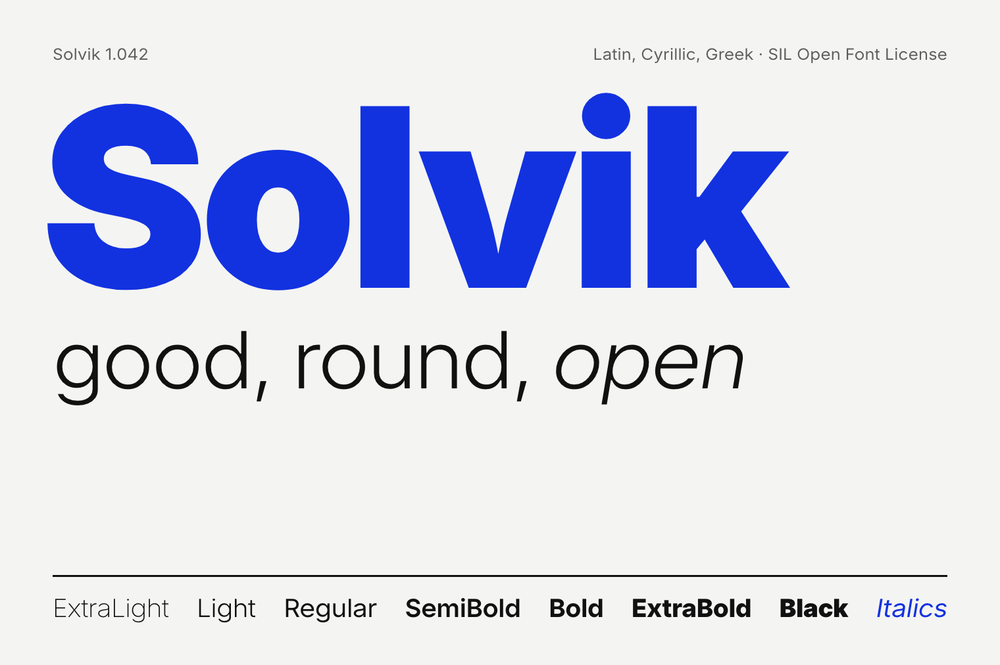

## Specimens

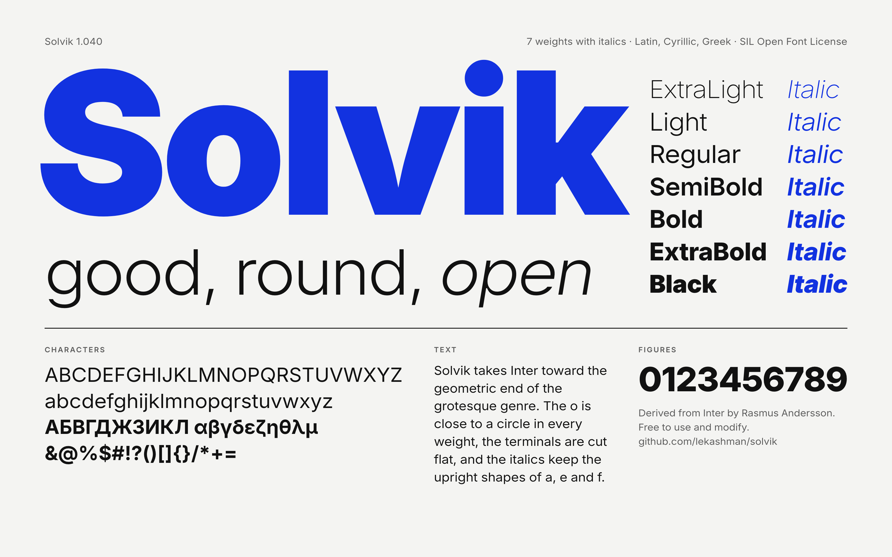

Seven weights, from ExtraLight to Black, each with an italic:

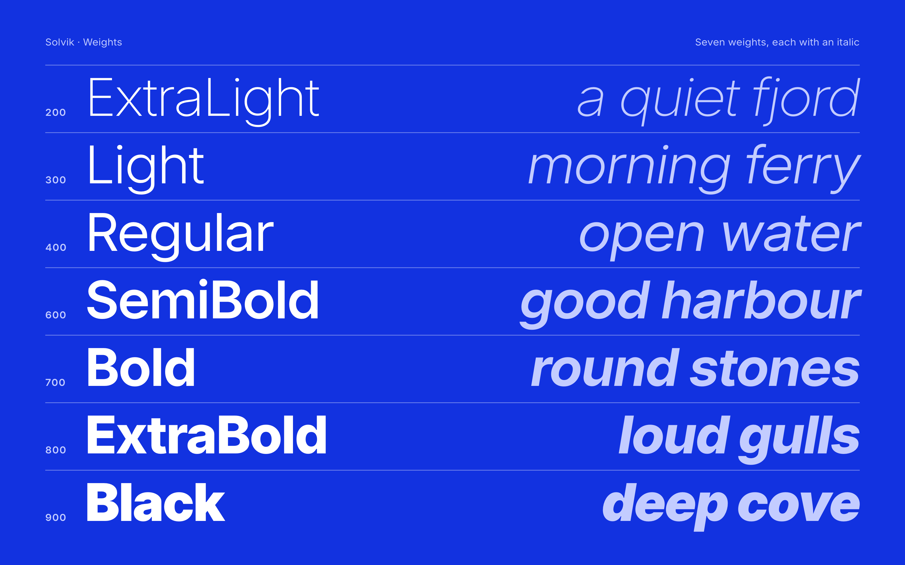

In an interface, with Regular and SemiBold at 11 to 16 px and Light for large numbers:

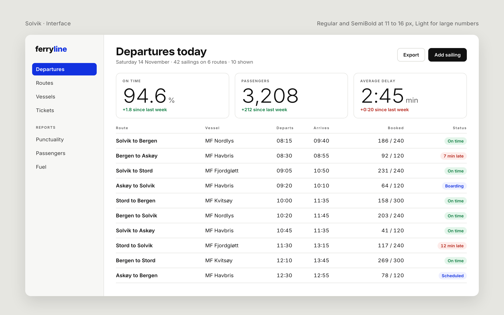

In editorial text, with an ExtraBold headline, a Light Italic deck and Regular body text:

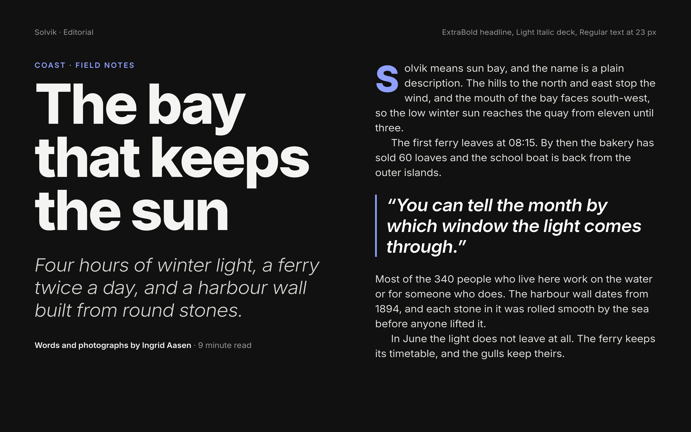

In a long article, with a Bold title, a Light lead and Regular text at 18.5 px:

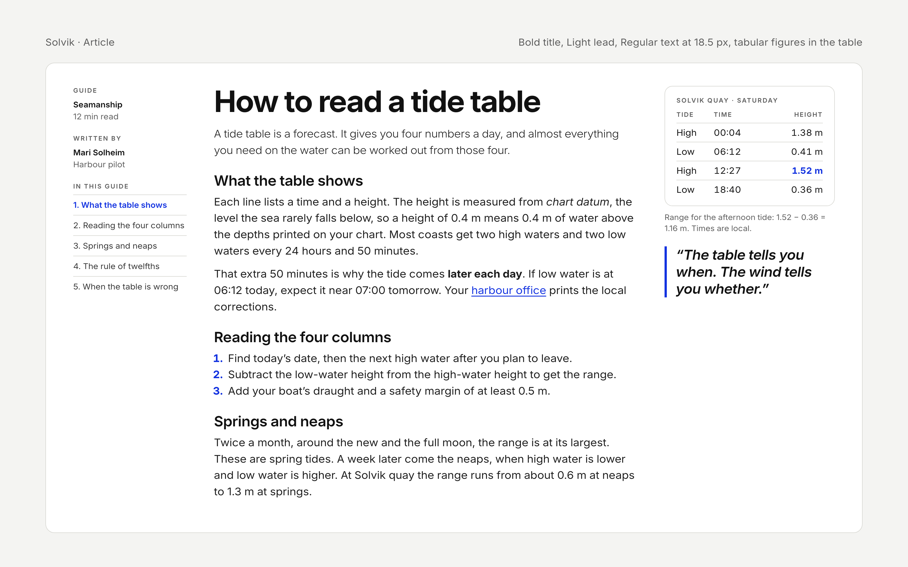

On a web page, with an ExtraBold headline and Light numerals:

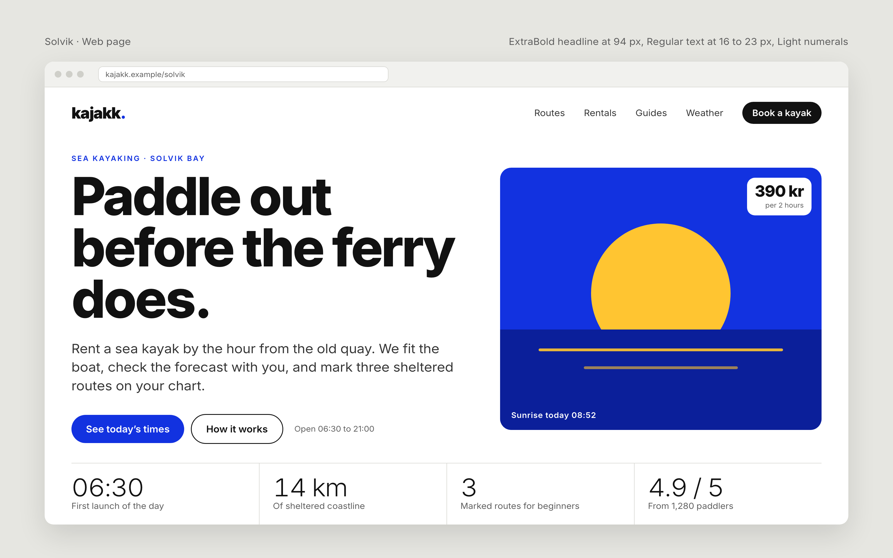

In a slide deck, the use Solvik was made for. Eight slides in the Standard Deck layout from
[slidedeck.co](https://slidedeck.co), set in all seven weights: Black against Light and ExtraLight
in the titles, ExtraBold for emphasis inside a Light sentence, and three figures in Black, Regular
and ExtraLight:

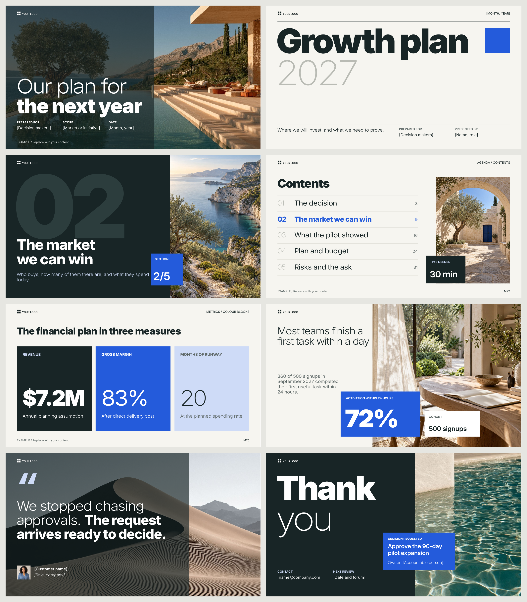

In logos. The nine names are invented for the specimen:

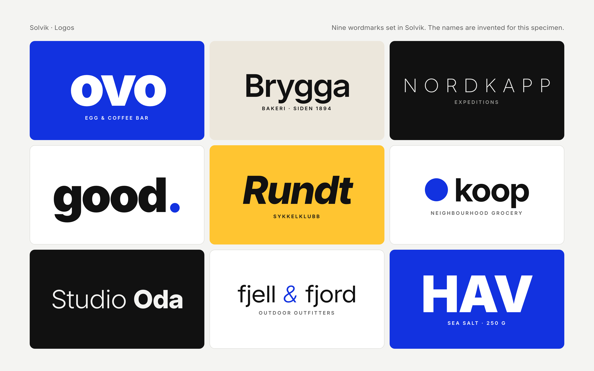

Characters and languages:

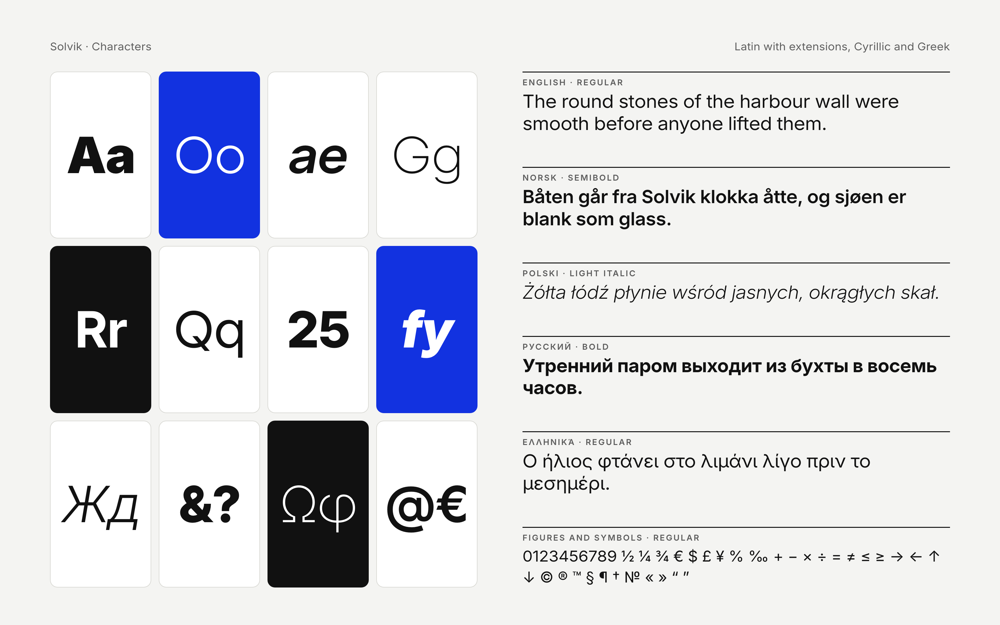

Languages. Google Fonts' [shaperglot](https://github.com/googlefonts/shaperglot) 1.2.2 reports
792 languages as supported in every style: 723 written in Latin script (Vietnamese included),
68 in Cyrillic, and Greek.

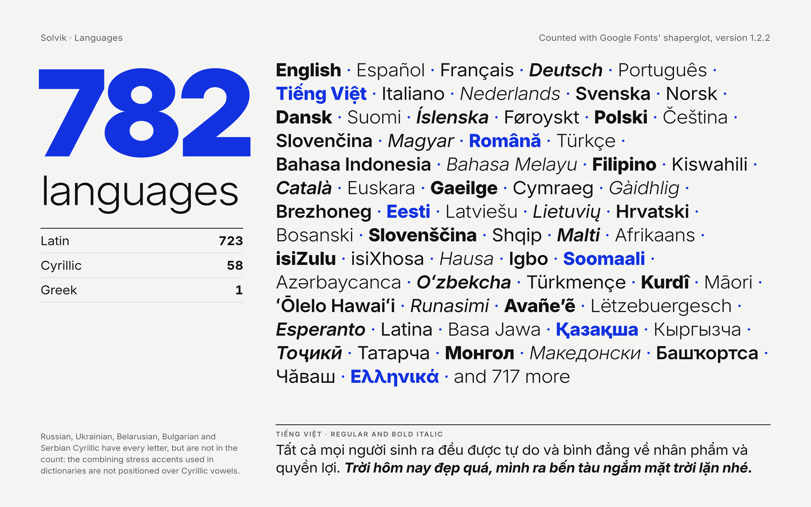

The specimen pages are HTML files in `documentation/specimens`. Open one in a browser to see the
fonts live, or run `sh scripts/render-specimens.sh` to render them to the images above. The slide image is the exception: it is rendered from a
PowerPoint file that is not in this repository.

## How it differs from Inter

- Round letters are widened so the o is close to a circle in every weight; stroke weight is unchanged.
- Terminals are cut flat.
- Horizontal strokes are held closer to the verticals in SemiBold and heavier.
- Italic a, e and f are the upright letters slanted, not Inter's cursive forms.
- Figures are wider, by about 8% in Regular. Straight-sided letters are about 2% wider. Both
  differences shrink toward Black, where they are about 1%.
- Spacing and kerning are rebuilt for the new shapes. Among the 331 Latin letters, figures and
  punctuation marks checked (Basic Latin, Latin-1, Latin Extended-A and common punctuation), no
  two sit closer than 8% of the stem width in any style. The exceptions are pairs that join by
  design: ff, ft, tt and runs of dashes or underscores.

## Building

The repository follows the [Google Fonts project template](https://github.com/googlefonts/googlefonts-project-template).
Fonts are built from the UFO sources in `sources/` with [gftools builder](https://github.com/googlefonts/gftools),
configured in `sources/config.yaml`:

    make build

This creates a Python environment in `venv/`, installs the tools listed in `requirements.in`, and
writes the fonts to `fonts/ttf`. `make test` checks them with
[fontspector](https://github.com/fonttools/fontspector) and `make proof` writes proof pages to
`out/proof`. `scripts/derivation` documents how the sources were derived from Inter.

## Status

- Static fonts only. There is no variable font yet.
- The fonts are unhinted, with a `gasp` table and smart dropout control set.
- Each font has a STAT table, added by `scripts/add_stat.py` at build time.
- Combining marks are positioned over Cyrillic and Greek letters as well as Latin ones, so stress
  accents work in Russian, Ukrainian, Belarusian, Bulgarian and Serbian. The Inter fonts Solvik was
  derived from register their mark features for Latin only.
- Characters: Latin (including extended), Cyrillic and Greek, as in Inter, plus U+030B.

## Credits

- Andrew Lekashman: author and maintainer of Solvik. <andrew@lekashman.com>
- Rasmus Andersson: designer of [Inter](https://github.com/rsms/inter), the typeface Solvik is
  derived from. Inter is copyright The Inter Project Authors.

AI tools were used in the creation of this project.

## License

This Font Software is licensed under the SIL Open Font License, Version 1.1. This license is in
this repo, in `OFL.txt`, and is also available with a FAQ at: https://openfontlicense.org

## Changelog

**1.040** (November 2026) First release built from UFO sources, with gftools builder. Weight 600 named SemiBold.
Added U+030B. Mark positioning extended to Cyrillic and Greek. Kerning added for
pairs that touched, mostly with the long s and in the heavy weights. Private-use codepoints for alternates removed; the alternates remain available through
their OpenType features.
